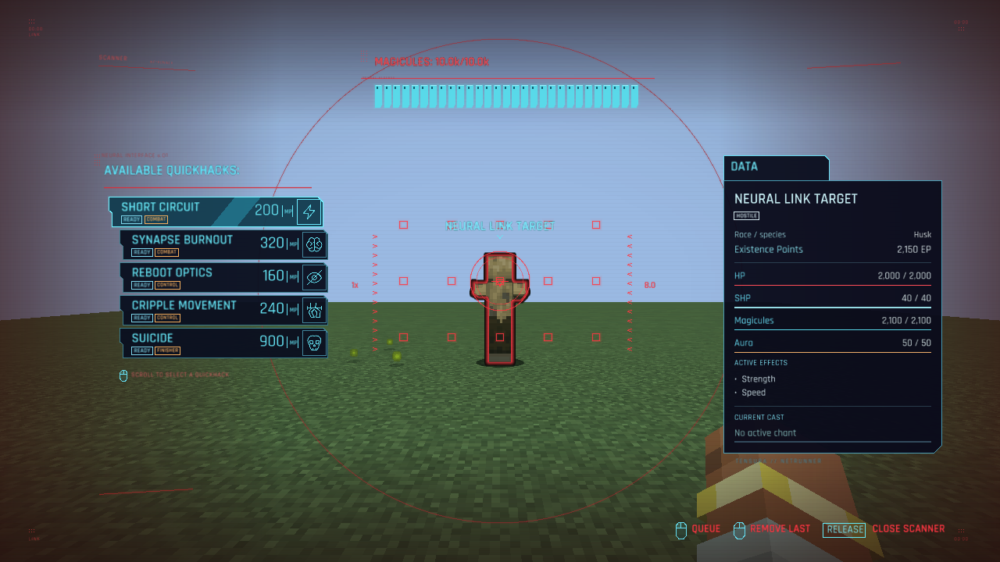
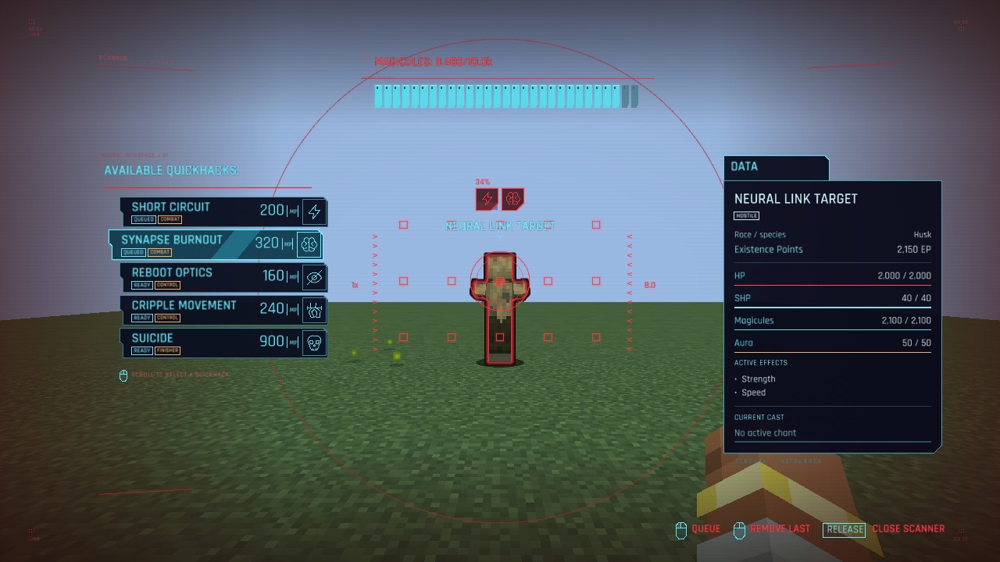
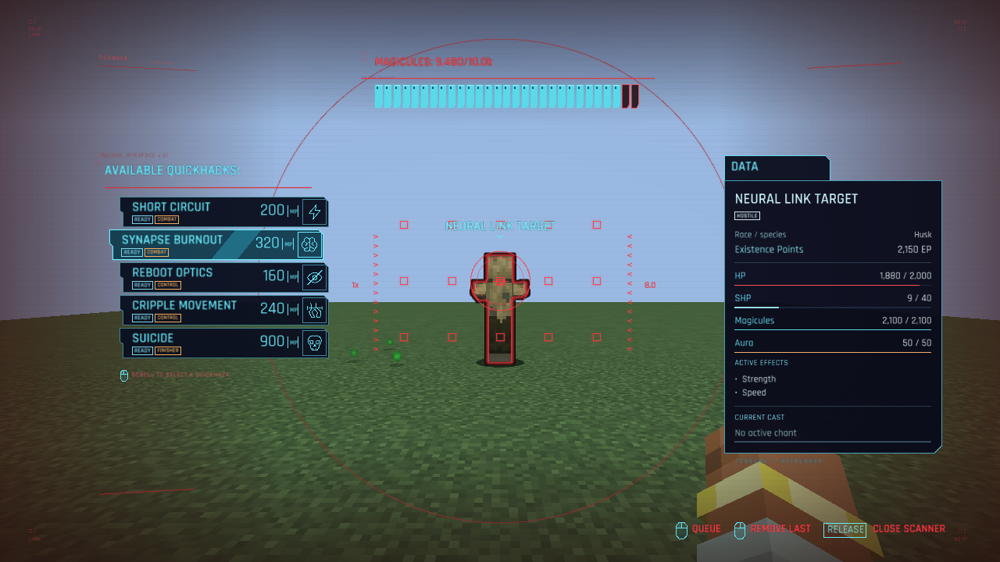

# Netrunner

[All wikis](../README.md) · [TensuraAdditionalAdditions](TensuraAdditionalAdditions.md)

| Skill data | Value |
| --- | --- |
| Tier | Unique |
| Obtaining | Reincarnation Unique pool; [Archivist](Additions-Archive-of-Accord.md) mentorship |
| Ability | Quickhack · Active, Hold |
| Mastery | Upload times are halved (50% shorter) |

## Quickhack · Active, Hold

Equip the ability in Tensura’s normal skill slots. **Hold its key**, aim at a living target, then **scroll** to choose a quickhack and **left-click** to queue it. **Right-click** cancels the latest upload. Release the key to close the scanner; uploads continue.

The scanner shows the target’s HP, SHP, magicules, aura, status effects and current chant. Upload icons appear above each target’s head. Three uploads can be queued at once; they execute in order and follow moving targets.

- Link a visible target within **32 blocks**; it must remain within **48 blocks** during upload.
- Each quickhack has its own cooldown, starting when queued. Magicules are paid immediately; cancellation, death or loss of connection does not refund them.
- Allies, owned pets and protected players are excluded. Normal PvP rules apply.
- Death, dimension changes, logout, losing the skill or skill interference cancel outstanding uploads.

**Damage type:** None for scanning; see each quickhack below. Opening the scanner costs nothing. The lens acquires the target first; the resource cells and quickhack panels assemble next. Queue controls become ready after this brief opening animation.

[Watch the native HUD animation](../media/netrunner-native-hud.mp4) — updated in-game recording of the staged opening, detailed chip cards, queueing, uploads after release and reopening.

[Opening animation stages](../media/netrunner-opening.png)

## Short Circuit · Upload

Deal **120 Lightning HP damage**, increased to **180** against a target currently casting.

**Damage type:** Lightning (`tensura:lightning`). **Cost:** 200 magicules. **Upload:** 2 seconds. **Cooldown:** 2 seconds.

## Synapse Burnout · Upload

Deal **70 + 140 × missing-magicule fraction** SHP damage. Spiritual Attack Resistance halves it; Spiritual Attack Nullification blocks it.

**Damage type:** Mind Crush, spiritual damage (`tensura:mind_crush`). **Cost:** 320 magicules. **Upload:** 2.5 seconds. **Cooldown:** 3 seconds.

## Reboot Optics · Upload

Disrupt the target’s vision for **5 seconds**. Affected mobs lose their target and stop navigating; players suffer a dark, glitching view.

**Damage type:** None. **Cost:** 160 magicules. **Upload:** 1.5 seconds. **Cooldown:** 4 seconds.

## Cripple Movement · Upload

Root the target for **3 seconds**, stopping horizontal movement and upward motion. Attack speed is unchanged.

**Damage type:** None. **Cost:** 240 magicules. **Upload:** 2 seconds. **Cooldown:** 4 seconds.

## Suicide · Upload

Force a self-directed strike that deals resistible mental HP damage: **200% maximum HP** against ordinary mobs, **45%** against players and tagged bosses. It uses the normal damage pipeline; defenses and fatal-hit regeneration can prevent death.

**Damage type:** Mind Crush (`tensura:mind_crush`). **Cost:** 900 magicules. **Upload:** 5 seconds. **Cooldown:** 15 seconds.

All numbers are defaults. Server settings and native combat modifiers can change the outcome. Netrunner is excluded from Fettered Human’s default reincarnation pool and from Metis auto-casting.

## Display examples

[4:3 layout](../media/netrunner-four-three.png) · [Ultrawide layout](../media/netrunner-ultrawide.png)
